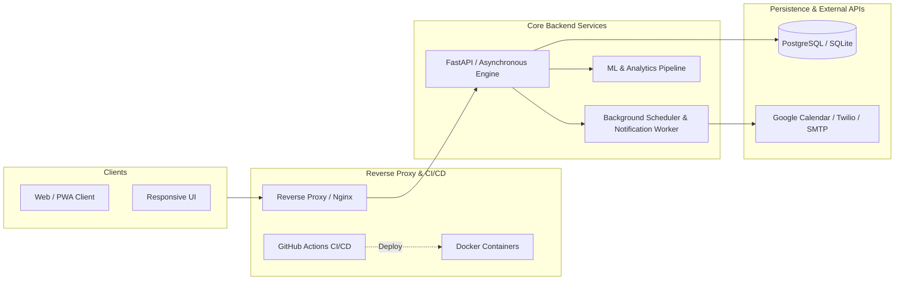

# ⚡ Bijan Sarkar

  <b>CSE Student &bull; Aspiring Backend, Cloud, DevOps & ML Engineer &bull; Open-Source Enthusiast</b>

  
  
  
  

---

## 📌 Executive Summary

I am a Computer Science & Engineering undergraduate focusing on **Backend Systems Architecture**, **Cloud Infrastructure**, **DevOps Automation**, and **Applied Machine Learning**. 

- 🚀 **Backend Engineering:** Designing resilient, high-throughput asynchronous REST APIs with **FastAPI**, **Python**, and **Node.js** following Clean Architecture principles.
- ☁️ **Cloud & DevOps:** Containerizing full-stack microservices with **Docker**, standardizing multi-environment orchestration via **Docker Compose**, and automating testing/deployments with **GitHub Actions CI/CD**.
- 🧠 **Machine Learning & Data Pipelines:** Developing data ingestion, preprocessing, and predictive workflows utilizing **NumPy**, **Pandas**, **Scikit-Learn**, and **Streamlit**.
- 🧩 **Algorithmic Foundations:** Practicing rigorous problem-solving and algorithmic complexity optimization in **C++** (Striver's A2Z, LeetCode, CS50).

---

## 🛠️ Technical Competencies

| Domain | Technologies, Frameworks & Tooling |
| :--- | :--- |
| **Backend & APIs** |      |
| **Cloud, DevOps & Containers** |      |
| **Databases & Storage** |     |
| **Data & Machine Learning** |     |
| **Systems & Problem Solving** |     |
| **Frontend & UI (Client-Side)** |     |
| **Dev Tools & Workflow** |      |

 

  

---

## 🏗️ Production Architecture & Featured Systems

 

| System | Architecture & Tech Stack | Engineering Highlights | CI / Status |
| :--- | :--- | :--- | :--- |
| **TaskMaster AI: Autonomous Scheduler & Worker Engine** | `FastAPI` `Docker Compose` `Next.js` `Worker Queues` `Twilio / SMTP` | Implements interval-packing scheduling algorithms to prevent double-booking; background worker handles automated escalation alerts across WhatsApp & email; 1-click Google Calendar synchronization. |  [🔗 Code](https://github.com/bijan-sarkar/task-master-app) |
| **DIU CSE Academic Platform & Predictive Engine** | `FastAPI` `React PWA` `TypeScript` `Tailwind` `SQLite` `Docker` | Comprehensive academic engineering platform; features empirical question pattern analysis algorithms calculating probability-weighted exam readiness metrics; fully containerized multi-stage Docker build. |  [🔗 Code](https://github.com/bijan-sarkar/DIU_semester-Tracker) |
| **Algorithmic Solutions & Systems Foundations** | `C++` `STL` `Data Structures` `Algorithms` `CS50x` | Implementation of core computer science fundamentals: graph traversals, dynamic programming, sorting/searching, and memory management with asymptotic time/space complexity analysis. |  [🔗 Code](https://github.com/bijan-sarkar/CS50-python) |
| **Pomoman: Precision Productivity Utility** | `JavaScript` `HTML5` `CSS3` `Local Storage` | Zero-dependency, lightweight Pomodoro state engine with offline persistence and interactive session analytics. |  [🔗 Code](https://github.com/bijan-sarkar/Pomoman) |

---

## ⚙️ DevOps & Engineering Standards

- **Infrastructure as Code & Containerization:** Multi-stage `Dockerfile` images optimizing layer caching and footprint; `docker-compose.yml` defining reproducible local environments.
- **Continuous Integration (CI):** Automated linting (`Ruff`, `ESLint`), type checking (`mypy`, `tsc`), and test coverage reporting via GitHub Actions.
- **Git Hygiene:** Semantic commit history adhering to the [Conventional Commits](https://www.conventionalcommits.org/) specification (`feat:`, `fix:`, `ci:`, `test:`, `docs:`).
- **Security First:** Strict separation of config and code: environment variables managed via `.env.example` templates; zero credentials or cache artifacts in tracking.

---

## 📊 Live Telemetry & GitHub Analytics

  
  

  

---

## 🐍 Continuous Contribution Activity

  <!-- Snake game generated dynamically via daily GitHub Actions workflow -->
  <picture>
    <source media="(prefers-color-scheme: dark)" srcset="https://raw.githubusercontent.com/bijan-sarkar/bijan-sarkar/output/github-contribution-grid-snake-dark.svg">
    <source media="(prefers-color-scheme: light)" srcset="https://raw.githubusercontent.com/bijan-sarkar/bijan-sarkar/output/github-contribution-grid-snake.svg">
    
  </picture>

---

## 🤝 Connect & Collaborate

  
  &nbsp;
  
  &nbsp;
  

 

  🛠️ <i>"Simplicity is prerequisite for reliability."</i> — Edsger W. Dijkstra &bull; Maintained by <b>Bijan Sarkar</b>

